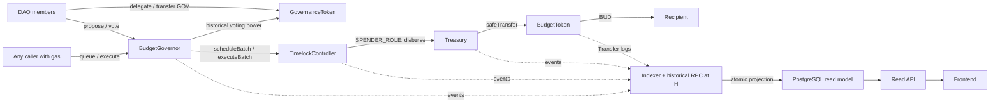

# DAO Budget Simulator — Smart Contracts & Governance (SC09)

Căn cứ: hai tài liệu yêu cầu phiên bản 1.0 ngày 11/10/2026 trong `docs/requirements/`.
Source review ngày **28/11/2026**: integrated Dev
`f15f19252957d9ca37b424facdbb13afc8da0b05`. `main` vẫn ở
`ad8c6cf17cced35c8ced5d6fcc5178b3f65892e4`; tài liệu này không promote release.
Sepolia preparation pin riêng là `e17ef61a8a51518005c38b0808cdc06fe7a68bbf`,
đã được [TV4 nhận owner/operator và xác nhận source](https://github.com/SE2026-21-1/dao-budget-simulator/issues/20#issuecomment-7240590072).
Không thay deployment pin bằng latest Dev hoặc commit tài liệu. Evidence lịch sử
giữ đúng SHA/run/chain riêng; không tự gán chúng cho source mới.

Full function/event/error signatures (gồm inherited và indexed flags) nằm trong
[catalog compiler](sc06-abi-reference.md); quy trình kiểm tra/bàn giao ở [SC06](sc06-handoff.md).
SC06 hiện có archive receipt Anvil và kiểm chứng versioned, không còn chỉ giai đoạn 1.
Xem [review dữ liệu TV2](reviews/sc09-backend-data-review.md),
[báo cáo TV1](report/tv1-smart-contracts.md), [8 slide kỹ thuật](slides/tv1-smart-contracts.md)
và [source/evidence/checks SC09](evidence/sc09-20261128/verification.json).

## Toolchain

| Thành phần | Cấu hình hiện tại |
|---|---|
| Foundry | 1.8.5 |
| Node / npm | Node 24.15.0 (`.nvmrc`); `npm ci` theo package-lock.json |
| Solidity | 0.8.37 |
| OpenZeppelin Contracts | 5.4.0, revision trong foundry.lock/submodule |
| forge-std | 1.17.0, revision trong foundry.lock/submodule |
| Optimizer | bật, 200 runs |
| EVM target | osaka; remote gas/fork support được kiểm riêng theo runbook Sepolia |

Solidity pragma `^0.8.20` của interface tương thích compiler đã khóa.
Governor OpenZeppelin 5.4.0 cần compiler tối thiểu 0.8.24.
Cách dựng môi trường và kiểm tra nằm trong README và mục tái lập bên dưới.

## Kiến trúc và cấu hình demo

GOV: ERC20Votes, nguồn cung cố định 1.000, A/B/C/D = 400/300/200/100.
BUD: ERC-20 không phí, mint một lần 20.000; Treasury nhận 10.000, ví nạp quỹ 10.000.
Hai token có 18 decimals; lượng on-chain = lượng token × 10^18.
TV1 bàn giao constructor và trình tự phân bổ cho TV4; không thêm public mint.

Threshold: 50 GOV voting power đã delegate tại checkpoint quá khứ theo Governor.
Quorum: 20% tổng cung tại snapshot. For + Abstain tính quorum; For phải lớn hơn Against.
Voting delay 60 giây, voting period 300 giây, Timelock delay 120 giây từ queue.
GOV override clock/CLOCK_MODE để dùng timestamp; Governor dùng cùng clock.
Người dùng gọi delegate(self); chuyển token/delegate sau snapshot không sửa trọng số đã chốt.

Luồng: ví → Governor → TimelockController → Treasury → BUD.transfer.
Pending → Active → Succeeded → Queued → Executed; nhánh Defeated hoặc Canceled.
Ready là tình trạng operation Queued, không phải proposal state mới.
Execute revert không tạo state Failed. Kiểm tra biên snapshot/deadline/ETA theo contract.
MVP không hỗ trợ proposal đổi role/tham số; muốn đổi cấu hình phải deploy lại.

### Năm contract và nguồn chân lý

| Contract thực tế | Trách nhiệm/state quan trọng | Giao diện và event chính | Quyền và invariant |
|---|---|---|---|
| `GovernanceToken` (`ERC20Votes`, `EIP712`) | GOV balances, delegates, timestamp checkpoints và past supply | `delegate`, `getVotes`, `getPastVotes`, `getPastTotalSupply`, `clock`; `Transfer`, `DelegateChanged`, `DelegateVotesChanged` | Holder chọn delegate; delegated votes khác token balance; fixed supply 1.000 GOV |
| `BudgetToken` (`ERC20`) | BUD balances/allowances; mint một lần cho initialHolder | `transfer`, `approve`, `transferFrom`, `balanceOf`; `Transfer`, `Approval` | ERC20 holder/allowance; không public mint, không fee; fixed supply 20.000 BUD |
| `Treasury` (`ITreasury`, `AccessControl`) | immutable `budgetToken`, `paidRequests`, role membership | `disburse`, `paidRequests`, `hasRole`; `BudgetDisbursed`, role events | `SPENDER_ROLE` mới được disburse; mỗi request thành công tối đa một lần; admin không tự có quyền chi |
| `BudgetGovernor` + 6 OZ modules | proposal core, vote receipts/tallies, quorum history, operation mapping; immutable Treasury | propose/vote/cancel/queue/execute/read; proposal/vote events | Threshold, snapshot và BR02–04; không giải ngân trực tiếp, không tạo action ngoài Treasury |
| OZ `TimelockController` | `_timestamps`, minDelay và roles | schedule/execute batch, hash/state/read; `CallScheduled`, `CallExecuted`, `CallSalt`, `Cancelled`, `MinDelayChange` | Governor sole proposer/executor/canceller; chỉ Ready được execute; operation Done không replay |

Governor ghép `GovernorSettings`, `GovernorCountingSimple`, `GovernorVotes`,
`GovernorVotesQuorumFraction`, `GovernorTimelockControl` trên base `Governor`.
Timelock nằm trong dependency đã khóa, không có contract Timelock tự viết trong dự án.
Treasury chỉ kiểm token có code, không tự chứng minh token bất kỳ là fee-free BUD;
deployment identity/audit phải ràng buộc đúng BudgetToken.



On-chain contracts quyết định voting/state/roles/payment. SQL/API là read model
đã đối chiếu tại H, có độ trễ và có thể bị invalidated; không có quyền thay luật
chain. Backend không giữ khóa để ký thay user. Frontend gửi qua wallet; đọc lại
contract trước thao tác không được thay bằng browser clock hoặc HTTP 200.

### Tham số: constructor constants và deployment configuration

| Tham số | Demo đã xác minh | Nguồn/khả năng cấu hình |
|---|---|---|
| GOV / A,B,C,D | 1.000 / 400,300,200,100 | Hardcoded mint trong `GovernanceToken` constructor; bốn địa chỉ được truyền vào |
| BUD | 20.000, decimals 18 | Hardcoded mint một lần trong `BudgetToken`; initialHolder là argument |
| Treasury ban đầu | 10.000 BUD | Script seed bằng transfer **sau audit**, constructor Treasury không tự nạp tiền |
| Threshold | 50 GOV | `GovernorSettings(60,300,50 ether)` trong constructor Governor |
| Quorum | 20/100 = 200 GOV với demo | Initial numerator 20; denominator 100 của OZ; dùng supply/numerator quá khứ |
| Voting delay / period | 60 / 300 giây | Giá trị initial constructor Governor, timestamp clock |
| Timelock delay | 120 giây | Constructor argument từ `CONFIG.minDelay` của deployment scripts |

Các setter kế thừa vẫn có trong ABI nhưng bị `onlyGovernance`/Timelock-self và
MVP proposal filter hạn chế; không phải setting có thể đổi từ dashboard. Final
role graph và action filter khiến đường đổi cấu hình đó không khả dụng trong
luồng MVP đã audit. Không gọi mọi tham số là Solidity `constant` hoặc `immutable`.

Self-delegation kích hoạt voting units cho chính holder; delegate sang người khác
chuyển quyền biểu quyết, không chuyển token. Checkpoints ghi voting units theo
`block.timestamp`; nhiều cập nhật cùng timestamp gộp vào checkpoint đó. Governor
kiểm threshold tại `clock()-1`, còn trọng số vote tại proposal snapshot S.
`getPastVotes/getPastTotalSupply(S)` chỉ đọc được khi `clock()>S`. Chuyển token
hoặc đổi delegate **sau S** làm current votes đổi nhưng không sửa checkpoint S;
chuyển trong chính timestamp S vẫn thuộc snapshot, chưa là Active.

Quorum = floor(`getPastTotalSupply(S) * quorumNumerator(S) / quorumDenominator()`),
không lấy current balance hay tổng delegated supply. Support enum:
Against=0, For=1, Abstain=2. For+Abstain phải đạt quorum **và** For>Against;
tie hoặc chỉ Abstain không thắng. Một voter chỉ vote một lần/proposal.

| BR | Cơ chế thực tế / evidence đọc source |
|---|---|
| BR01 | GOV timestamp checkpoints; GovernorVotes đọc past votes tại S; token/Governor snapshot tests |
| BR02 | GovernorCountingSimple `_quorumReached` + `_voteSucceeded`, `hasVoted`; quorum/Against/tie tests |
| BR03 | Governor validate recipient/amount/action count; Treasury paidRequests và checks-effects-transfer |
| BR04 | `_propose` kiểm target/value/selector/canonical payload, cả direct propose |
| BR05 | Balance check tại Treasury execute; revert rollback; `testInsufficientBudgetRetriesSameReadyOperation` |
| BR06 | OZ `_validateCancel`: creator + Pending; target filter chặn đổi role/settings |
| BR07 | Public Governor queue/execute, Timelock delay; non-holder/ETA integration tests |

Không phát hiện discrepancy production mới giữa BR01–BR07 và source đã đọc;
kết luận phụ thuộc final roles và clean bootstrap, không phải quyền admin tùy ý.

## Hàm public/external dành cho consumer

| Contract | Hàm/giao tiếp | Consumer |
|---|---|---|
| GOV | balanceOf, totalSupply, decimals, delegates, delegate, getVotes, getPastVotes, getPastTotalSupply, clock, CLOCK_MODE | TV3, TV2, test |
| BUD | balanceOf, totalSupply, decimals, transfer, approve, allowance, transferFrom | TV2/TV3/TV4 |
| Treasury | disburse(bytes32 requestId,address recipient,uint256 amount) | Timelock |
| Treasury | budgetToken() → address; paidRequests(bytes32) → bool; hasRole(bytes32,address) → bool | consumer/role test |
| Governor | propose, castVote, cancel, queue, execute, hashProposal, state, proposalSnapshot, proposalDeadline, proposalVotes, quorum, proposalEta, proposalProposer, hasVoted | TV2/TV3 |
| Timelock | getMinDelay, getTimestamp, hashOperationBatch, isOperationReady, isOperationDone, hasRole | TV2/TV4 |

Governor chỉ chấp nhận đúng một target Treasury, một value = 0 và một calldata disburse.
Kiểm tra selector, giải mã calldata, recipient khác zero/Treasury, amount > 0 ngay on-chain.
Không chỉ kiểm tra ở helper hoặc dashboard; gọi propose chuẩn cũng phải bị kiểm soát.
Treasury kiểm tra lại dữ liệu, quyền và requestId; chỉ giữ địa chỉ BUD đã cấu hình.
Native-value restriction ở đây là **action `values[0]`**, không phải khẳng định
mọi entrypoint Governor là nonpayable: queue/execute kế thừa có payable. Demo/UI
gửi không kèm native ETH; ngân sách/ledger chỉ tính configured BUD.
Nạp quỹ bằng BUD.transfer vào Treasury, không cần hàm deposit riêng.
Không giữ chỗ ngân sách khi propose. Thiếu tiền tại execute revert toàn bộ, không tiêu thụ
requestId, không đánh dấu Executed; nạp thêm rồi thử lại được.

### Validation của proposal (điểm vào chuẩn cũng bị kiểm)

Source: [`BudgetGovernor._propose`](../contracts/BudgetGovernor.sol),
[`Governor.propose`](../lib/openzeppelin-contracts/contracts/governance/Governor.sol).
Các test dưới đây thuộc [`BudgetGovernor.t.sol`](../tests/unit/BudgetGovernor.t.sol);
đây là source mapping, không phải danh sách test vừa chạy lại trong đợt SC09.

| Invalid input | Validation location | Expected result | Test/evidence |
|---|---|---|---|
| Không đủ delegated past votes | OZ `propose`, trước `_propose` | `GovernorInsufficientProposerVotes(address,uint256,uint256)` | `testBelowThresholdCannotPropose`, `testDelegationMustBePastForThreshold` |
| Số phần tử không đúng 1 ở bất kỳ array | Governor `_propose` | `InvalidActionCount(uint256,uint256,uint256)` | `testMultipleActionsRejected`, `testFuzzMismatchedArrayLengthsRejected` |
| Target khác Treasury, kể cả Governor/Timelock | `_propose` | `InvalidTarget(address)` | `testWrongTargetRejectedOnDirectPropose`, `testGovernorSettingsProposalRejected` |
| Native action value khác 0 | `_propose` | `InvalidNativeValue(uint256)` | `testNativeValueRejected` |
| Sai selector, length khác 100 bytes, trailing bytes | `_propose` | `InvalidCalldata()` | `testWrongSelectorWithCorrectLengthRejected`, `testTrailingDataRejected`, length fuzz |
| Address ABI word có dirty high bits | Strict `abi.decode` của `_propose` | Decoder revert; không bịa custom-error selector | `testDirtyAddressPaddingRejected` (expectRevert không định danh error) |
| Recipient zero hoặc Treasury | `_propose` và Treasury `disburse` | `InvalidRecipient(address)` | `testZeroRecipientRejected`, `testTreasuryRecipientRejected` |
| Amount = 0 | `_propose` và Treasury | `InvalidAmount(uint256)` | `testZeroAmountRejected` |
| Arrays + description tạo proposalId đã tồn tại | OZ `_propose` | `GovernorUnexpectedProposalState(uint256,uint8,bytes32)` | `testCopiedProposalCannotReplaceFirstCreatorOrCancelRights` |

Amount lớn hơn quỹ hoặc requestId đã dùng **không** bị reserve/reject chỉ vì propose:
Treasury kiểm tại execute. `bytes32(0)` hợp lệ; không tự thêm prohibition. Token
decimals/title/body validation phía UI không thay thế on-chain action validation.

## Event và custom errors từ implementation

ITreasury hiện có:

```solidity
function disburse(bytes32 requestId, address recipient, uint256 amount) external;
event BudgetDisbursed(bytes32 indexed requestId, address indexed recipient, uint256 amount);
```

ABI: nonpayable, không có return; event không anonymous, amount không indexed.
BudgetDisbursed chỉ phát khi thanh toán thành công. BUD Transfer là nguồn tính dòng tiền;
event Treasury liên kết requestId, không cộng cả hai thành hai lần chi.
Governor dùng ProposalCreated, VoteCast, VoteCastWithParams, ProposalQueued, ProposalExecuted, ProposalCanceled.
Timelock dùng CallScheduled, CallExecuted, Cancelled và CallSalt khi áp dụng.
GOV dùng DelegateChanged, DelegateVotesChanged; token dùng Transfer/Approval.
ABI sinh từ build là nguồn chính xác cho tên, kiểu, indexed và lỗi OpenZeppelin.

Catalog [SC06 ABI reference](sc06-abi-reference.md) liệt kê đầy đủ errors của cả token,
Treasury, Governor, Timelock và ITreasury, bao gồm inherited errors cùng kiểu tham số.
Ví dụ lỗi Governor thực tế là `InvalidActionCount(uint256,uint256,uint256)` cho độ dài
của targets/values/calldatas; không dùng chữ ký SC01 cũ một tham số.
TV3 decode revert bằng ABI của contract/đường gọi, không dựa vào chuỗi thông báo RPC.
ABI có hàm quản trị kế thừa không có nghĩa ví được gọi hoặc Governor cho phép đề xuất hàm đó.

## Role sau khởi tạo

| Role | Chủ thể duy nhất |
|---|---|
| Treasury SPENDER_ROLE | TimelockController |
| Treasury DEFAULT_ADMIN_ROLE | TimelockController |
| Timelock PROPOSER_ROLE | BudgetGovernor |
| Timelock EXECUTOR_ROLE | BudgetGovernor, không mở cho zero address |
| Timelock CANCELLER_ROLE | BudgetGovernor |
| Timelock DEFAULT_ADMIN_ROLE | chính TimelockController |

TV1 sở hữu thiết kế quyền, integration tests và tài liệu SC05; TV4 sở hữu deploy/check-roles,
operation preflight và bằng chứng triển khai. Trình tự bàn giao SC05:
deploy GOV/BUD → Treasury → Timelock → Governor → grant role cuối cùng → preflight →
cleanup/revoke role tạm → kiểm lại trước renounce → renounce admin bootstrap cuối cùng →
final audit → funding Treasury. Không nạp BUD trước khi final audit đạt.

Preflight kiểm identity/config/liên kết contract, admin graph, toàn bộ lịch sử role và operation
từ deployment đến cùng block H/hash. Trước cleanup chỉ chấp nhận final holders cộng bootstrap
đã duyệt; trước renounce chỉ còn bootstrap admin cuối cùng ngoài final matrix. Chính sách bootstrap
mới là không có operation từng được schedule, kể cả đã cancel hoặc Done. Revoke proposer không
xóa operation cũ. Gate lỗi phải dừng renounce/funding; sau renounce audit lại trước funding.
Xem trình tự và giới hạn đầy đủ trong [SC05](sc05-timelock-roles.md).

**Cập nhật source tích hợp 28/11:** blocker operation preflight của bàn giao SC05 cũ
đã được xử lý trong `deployGovernance/checkGovernanceRoles/auditGovernanceRoles`
ở [`governance_local.mjs`](../scripts/governance_local.mjs), và đường remote tại
[`governance_sepolia.mjs`](../scripts/governance_sepolia.mjs). Local flow không tạo
operational roles tạm nên cleanup-complete gate chính là bootstrap audit trước
hai renounces; remote lặp full audit ngay trước renounce đầu, audit final trước
funding và tại K2 lẫn tip. Không mô tả đây còn là thiếu implementation.
[Security approval](https://github.com/SE2026-21-1/dao-budget-simulator/pull/60#pullrequestreview-6037012460)
và [evidence SC09](evidence/sc09-20261128/verification.json) giữ đúng source scope.
Foundry helper riêng vẫn không thay bằng chứng script; actual Sepolia deployment
và role audit của deployment đó chưa tồn tại để nghiệm thu.
Mọi ví có thể queue/execute qua Governor khi hợp lệ; ví thường không schedule/execute trực tiếp Timelock.
Không có đường chi riêng của deployer hoặc hủy khẩn cấp sau Pending; chỉ creator hủy Pending.

### Bootstrap so với quyền cuối cùng

| Đối tượng | Trước handoff | Sau final audit |
|---|---|---|
| Deployer | Treasury DEFAULT_ADMIN_ROLE; Timelock DEFAULT_ADMIN_ROLE, có thể grant roles trong bootstrap | Renounce cả hai admin; không spender/proposer/executor/canceller; không lấy lại quyền |
| Timelock | Self-admin từ constructor, sau grant thêm Treasury admin/spender | Treasury sole admin/spender, Timelock self-admin |
| Governor | Ban đầu chưa có Timelock roles, nhận ba grants | Sole PROPOSER_ROLE / EXECUTOR_ROLE / CANCELLER_ROLE của Timelock |
| DAO members | GOV holders/delegates, không được Treasury/Timelock operational roles | Propose khi đủ threshold, vote theo snapshot, creator cancel Pending; queue/execute qua Governor khi đủ điều kiện |
| Arbitrary caller / outsider | Không có quyền đặc biệt | Có thể gọi Governor queue/execute; không trực tiếp schedule/execute/cancel Timelock hoặc disburse |
| Funding account | BUD initialHolder | Transfer BUD để nạp Treasury; không phải admin/spender hay mặc định native ETH funder |
| Recipient | Chưa nhận payout | Nhận BUD; không có role hoặc quyền nhận khoản chi khác |
| Treasury | Giữ BUD, cấp bootstrap admin | Không bỏ phiếu/schedule; thực hiện transfer khi caller có spender role |

Timelock constructor được truyền proposers/executors rỗng; deployer không tự là
spender hoặc proposer. AccessControl admin có thể cấp quyền trong bootstrap nên
phải audit **toàn lịch sử**, không chỉ kiểm vài địa chỉ cuối. Không schedule operation
trong clean bootstrap, kể cả operation đã Cancelled/Done. Revoke không xóa operation
cũ; không funding nếu gate fail. Quyền của ví tại Governor không truyền thành role
của ví tại Timelock: bên gọi Timelock khi queue/execute là **Governor contract**.

### Vì sao Governor → Timelock → Treasury?

Governor quyết định proposal có hợp lệ và thắng phiếu hay không. Timelock buộc
khoản chi đã thắng phải được xếp lịch và chờ đủ delay, tách quyết định biểu quyết
khỏi thời điểm thực thi. Treasury giữ quỹ, kiểm request/balance và chỉ tin caller
được cấp SPENDER_ROLE là Timelock. Governor không có spender để gọi tắt Treasury;
EOA gọi Governor không có Timelock roles. Nhờ vậy người xem có khoảng chờ quan
sát khoản chi và quyền chi vẫn bị giới hạn bởi role graph đã audit. Khoảng chờ
không tạo quyền hủy khẩn cấp sau Pending trong MVP, không là quỹ dự phòng/reservation.

```mermaid
sequenceDiagram
    actor Member
    actor Caller
    participant G as BudgetGovernor
    participant L as TimelockController
    participant T as Treasury
    participant B as BudgetToken
    participant R as Recipient
    Member->>G: propose(one disburse action, description)
    Note over Member,G: Wait until chain clock is greater than snapshot
    Member->>G: castVote(proposalId, support)
    Note over G: Wait past deadline; Succeeded requires quorum and For greater than Against
    Caller->>G: queue(arrays, descriptionHash)
    G->>L: scheduleBatch(arrays, zero predecessor, salt, minDelay)
    L-->>G: CallScheduled / CallSalt
    G-->>Caller: ProposalQueued with ETA
    Note over Caller,L: Wait until chain timestamp is at least ETA
    Caller->>G: execute(same arrays, descriptionHash)
    G->>L: executeBatch(same operation)
    L->>T: disburse(requestId, recipient, amount)
    T->>B: safeTransfer(recipient, amount)
    B->>R: BUD balance increases
    B-->>T: Transfer
    T-->>L: BudgetDisbursed
    L-->>G: CallExecuted; operation Done
    G-->>Caller: ProposalExecuted; successful receipt
```

Số phiếu đủ hoặc hết delay không tự tạo transaction. Ví đủ gas phải gửi queue
và execute riêng. Nếu Treasury/transfer revert, toàn bộ execute rollback: không
giữ flags Executed/Done/paid và không có success logs trong canonical receipt.

## Proposal lifecycle và biên thời gian

```mermaid
stateDiagram-v2
    [*] --> Pending: propose
    Pending --> Active: chain clock greater than snapshot S
    Pending --> Canceled: creator cancel while Pending
    Active --> Succeeded: clock greater than deadline D and vote rules pass
    Active --> Defeated: clock greater than D and vote rules fail
    Succeeded --> Queued: queue transaction
    Queued --> Queued: execute reverts; top-up then explicit retry
    Queued --> Executed: execute at or after ETA succeeds
    Executed --> [*]
    Canceled --> [*]
    Defeated --> [*]
```

| Mốc/điều kiện | Trạng thái/hành vi chính xác | Source/test |
|---|---|---|
| `t <= S` (kể cả đúng S) | Pending; chưa vote, creator còn cancel | OZ `Governor.state/_validateCancel`; `testVotingWindowBoundaries`, `testCreatorCanCancelAtSnapshotWhileStillPending` |
| `S < t <= D` (kể cả đúng D) | Active; vote dùng past power tại S | `Governor.state`; `testVotingWindowBoundaries` |
| `t > D` | Succeeded nếu quorum+win, ngược lại Defeated; không có event tự động cho transition này | `GovernorCountingSimple`; quorum/tie tests |
| Queue | Chỉ Succeeded, đúng arrays/hash; scheduleBatch, ETA = queue block timestamp + getMinDelay | `testQueueByNonHolderEmitsBatchOperationAndETA`, queue-state negatives |
| `t < ETA` | Governor vẫn Queued, operation Waiting; execute revert | `testExecuteAtETAminusOneReverts` |
| `t >= ETA` | Operation Ready, Governor vẫn Queued cho đến execute thành công | `testTC01ExecuteExactlyAtETAByNonHolder`, ETA+1 test |
| Cancel | Public route: creator **và** Pending; Active trở đi không có emergency cancel | creator/noncreator/cancel-state tests |
| Reverted execute | Queued, Ready, chưa paid; nạp đủ BUD rồi retry cùng payload/operation | `testInsufficientBudgetRetriesSameReadyOperation` |
| Execute lại | Executed/Done và paid request không replay | `testExecuteCannotRepeatAfterDone`, shared-request tests |

OZ enum thực là Pending(0), Active(1), Canceled(2), Defeated(3), Succeeded(4),
Queued(5), Expired(6), Executed(7). Module hiện tại không có expiration/grace period
flow; không đưa Expired vào flow bắt buộc hoặc tạo Governor state Ready/Failed.
Timelock native OperationState là Unset/Waiting/Ready/Done; nhãn operation
Canceled trong API là derived từ log, không thêm enum Timelock. `getTimestamp`
Done trả marker **1**, không là execution timestamp; dùng timestamp block receipt.
Không lấy đồng hồ trình duyệt làm authoritative eligibility.

## Description v1, calldata và các identifier

Description là chuỗi JSON UTF-8: `{"version":1,"title":"...","body":"..."}`.
Title 5–120 ký tự, body 20–2.000 ký tự theo FR03; UI kiểm tra và escape bằng JSON serializer.
Frontend hiện đếm Unicode code point bằng `Array.from` trong
[`validateProposalForm/buildProposal`](../frontend/src/chain/transactions.ts).
Đây là kiểm tra nội dung UI; contract không parse JSON hoặc enforce title/body lengths.
Giữ nguyên chính xác chuỗi đã gửi trong ProposalCreated, kể cả khoảng trắng/thứ tự key.
Không parse rồi stringify lại khi queue/execute. descriptionHash = keccak256(bytes(description)).
Các giới hạn nội dung không thay thế kiểm tra khoản chi on-chain BR03–BR04.

Frontend `newRequestId` dùng `crypto.getRandomValues` 32 bytes trước propose;
lưu cùng form để retry. Không dùng timestamp hoặc JavaScript Number làm requestId.
Requirement không cấm bytes32(0); SC01 không tự thêm lệnh cấm. Hai proposal có thể cùng requestId,
nhưng Treasury chỉ thanh toán thành công một lần. requestId khác proposalId và operationId.

proposalId = uint256(keccak256(abi.encode(targets, values, calldatas, descriptionHash))).
predecessor = bytes32(0).
salt = bytes32(bytes20(address(governor))) XOR descriptionHash (địa chỉ padding bên phải đến 32 byte).
operationId = keccak256(abi.encode(targets, values, calldatas, predecessor, salt)), đối chiếu
Timelock.hashOperationBatch. Proposal luôn dùng batch dù chỉ một action; không dùng hashOperation single.
requestId nằm trong calldata và có thể thuộc nhiều proposal; proposalId không chứa proposer.
Cùng arrays/description thì cùng proposalId. operationId còn phụ thuộc Governor qua salt.

Ví dụ encode và chính sách bytes/uint256 đầy đủ nằm ở [SC06 handoff](sc06-handoff.md).
Sau execute, Timelock.getTimestamp(operationId) trả marker 1, không phải execution timestamp;
lấy timestamp từ block receipt. Ready là điều kiện operation, proposal vẫn Queued.
Không tạo state Failed khi execute revert; retry cùng arrays/hash sau khi nạp đủ quỹ.

Transaction hash là identity của signed transaction; queue và execute là hai
transaction hashes khác nhau cho cùng proposal/operation. Một requestId có thể ở
nhiều proposal; chỉ proposal thắng cuộc đua execute đầu tiên mới trả được request đó.
Không dùng transactionHash làm proposalId hoặc coi requestId unique ở bảng proposals.

Encode bằng compiler ABI (đơn vị nguyên, ví dụ 1.000 BUD = `1000000000000000000000`):

```javascript
const treasury = new Interface(treasuryAbi);
const calldata = treasury.encodeFunctionData('disburse', [requestId, recipient, 1000n * 10n ** 18n]);
const targets = [treasuryAddress], values = [0n], calldatas = [calldata];
const descriptionHash = keccak256(toUtf8Bytes(originalDescription));
```

Giữ nguyên UTF-8, newlines, khoảng trắng và key order của description đã propose;
không Unicode-normalize/trim/parse-stringify lại khi hash.
JSON trao đổi uint256 dùng chuỗi nguyên thập phân, bytes32 dùng hex; nội bộ bigint,
không dùng JS Number/parseFloat cho token amounts hoặc proposal IDs.

## Treasury accounting, atomicity và cạnh tranh ngân sách

`disburse` kiểm role → recipient → amount → paidRequests → balance; ghi paid trước
`SafeERC20.safeTransfer`, sau đó emit BudgetDisbursed. Revert của token/thiếu quỹ
rollback paid flag, balances và toàn bộ outer Governor/Timelock transaction.
Không có claim chống mọi arbitrary malicious token: mô hình dùng đúng BUD đã audit.

Treasury BUD balance(H) = tổng BUD vào(H) − tổng BUD ra(H), bắt đầu từ deployment.
Funding là BUD.transfer trực tiếp; token khác/native ETH không là BUD budget.
Proposed amount là yêu cầu, queued amount là kế hoạch đã schedule, executed amount
là payment thành công; chỉ khoản cuối làm thay balance. Proposal chưa execute không
reserve funds. Ví dụ quỹ 10.000, hai khoản 7.000/6.000 đều có thể thắng vote; execute
7.000 trước để lại 3.000, khoản 6.000 fail; top-up 3.000 rồi retry thì thành công.
Thứ tự execute và requestId trùng ảnh hưởng bên nhận; không thể hứa trước payout.

## Review dữ liệu tại H và chống tính đôi (SC09)

Ba loại snapshot khác nhau: voting snapshot S là **timestamp** chốt power;
indexer checkpoint H là **block number/hash** prefix đã ingest; API snapshot là
publication/cache gồm H/hash/timestamp/revision/scope. H raw có thể mới hơn H
projection; API phải ghi H projection, không trộn dữ liệu giữa chúng.

TV2 đọc `state`, `proposalVotes`, `quorum(S)`, operation timestamp và BUD balance
bằng EIP-1898 `{blockHash: hashH, requireCanonical: true}`; derive state bằng timestamp
của H và đối chiếu `state(H)`. Snapshot/deadline được lấy từ ProposalCreated trong
canonical history, không phải hai RPC reads proposalSnapshot/deadline riêng trong
`reconcile`. Empty blocks vẫn có thể đổi Pending/Active/Succeeded/Ready mà không log mới.

Raw dedup = chainId + transactionHash + logIndex, giữ blockHash/transactionIndex.
Một execute phát Transfer → BudgetDisbursed → CallExecuted → ProposalExecuted;
ledger **chỉ cộng Transfer**. BudgetDisbursed nối request/proposal/operation với đúng
Transfer cùng transaction/hash/recipient/amount/order; không là một dòng chi mới.
10.000 − 1.000 = **9.000 BUD**, không là 8.000. SQL/API dùng cùng published transfer rows.

Review source và accepted same-H evidence: **SC09 DATA REVIEW ACCEPTED — SCOPED TO
REVIEWED SOURCE**, theo [matrix, findings và limitations](reviews/sc09-backend-data-review.md).
Đây không thay peer review TV2/TV4 của PR tài liệu, không là live RPC mới hoặc full
backend campaign. API là read model, không state-root proof hoặc tức thời phát hiện
mọi reorg; trước gửi transaction vẫn đọc chain. Historical HTTP503 của Issue #19
giữ root cause UNKNOWN và documented limitation đã được nhóm nhận, không điều tra lại.

## What-if budget: trạng thái giả định khác state thực

**Chưa có engine What-if trong Dev được review.** Core/adapter ở Draft
[PR #62](https://github.com/SE2026-21-1/dao-budget-simulator/pull/62), source
`d4a0fb563e66be951760167a6f62b246821dc17c`, được đọc riêng; không import code hoặc
coi PR đã merge. SC06 chính thức là ABI/receipt handoff, không là tên engine What-if.
`fixtures/api/simulation.json` là synthetic timeline, không receipt hoặc backend endpoint mới.

[`simulateBudget`](https://github.com/SE2026-21-1/dao-budget-simulator/blob/d4a0fb563e66be951760167a6f62b246821dc17c/simulator/engine.ts)
nhận initial balance/paid IDs, proposals và explicit execute/top-up steps. Mỗi execute
kiểm supplied eligibility → proposal executed → request paid → balance; thành công
trừ amount và đánh dấu paid, thất bại giữ nguyên. Top-up hợp lệ cộng balance, không
đổi eligibility. Output hypothetical label, per-step trace, paid/executed/failed/
unattempted sets; invariant `initialBalance + appliedTopUps = finalBalance + disbursed`.
Không tự retry, sort hoặc enumerate mọi permutation. Amounts bigint/base units;
comparison chỉ so các kế hoạch explicit, không dự báo voting.

Với 10.000 BUD, P=7.000 rồi Q=6.000: P thành công, Q insufficient-budget, final3.000.
Đảo Q/P: Q thành công, P thất bại, final4.000. Top-up3.000 sau P rồi retry Q:
final0, disbursed13.000, appliedTopUps3.000. Đây là giả định ledger, không reserve.

[`readPinnedScenario`](https://github.com/SE2026-21-1/dao-budget-simulator/blob/d4a0fb563e66be951760167a6f62b246821dc17c/simulator/snapshot.ts)
là adapter opt-in: chain/H/hash, trusted runtime hashes, EIP-1898, balances/paid flags
cho **supplied requests only**, anchor trước/sau, deadline/abort; không fallback latest.
Eligibility/top-up vẫn là giả định; RPC transport/code-hash expectation là trust
boundary, không consensus proof. Adapter tests synthetic RPC khác Foundry VM
differential; chưa có live approved-RPC adapter acceptance. TV2/TV3 chưa có production
integration của engine; không nối simulate với transaction submission.

MVP không chống Sybil hoặc mọi hình thức mua voting power trước S; không reserve
ngân sách, bảo đảm future balance/vote result/execute thành công. What-if không mô
hình hóa Governor roles/quorum/timing/gas, global20.000 supply/funder balance hoặc
concurrency/reorg/finality. Blockchain finality phụ thuộc mạng; K2 không là consensus
finality. API latency không gồm thời gian chờ xác nhận testnet. Xem thêm report/slides.

## Security invariants và giới hạn bằng chứng

| Invariant | Contract mechanism | Test/evidence | Scope/limitations |
|---|---|---|---|
| INV01 mỗi request trả tối đa một lần | Treasury paidRequests + atomic transfer | Treasury duplicate/retry; integration shared request; GovernanceInvariant INV01 | Request zero hợp lệ; nhiều proposal vẫn chung payment uniqueness |
| INV02 mọi payout qua proposal/delay/Timelock | Governor filter + Timelock ready + final roles + clean bootstrap audit | Final-role/ETA/unauthorized/stale-operation tests; INV02 | Treasury riêng chỉ biết SPENDER_ROLE; bootstrap admin/stale operation sai có thể phá giả định |
| INV03 balance = in − out | Fee-free BUD + SafeERC20 + atomic ledger | Treasury conservation, INV03; TV2 Transfer-only ledger và balanceOf(H) | Không suy ra cho token tùy ý; không tính native ETH |
| INV04 weight theo snapshot, không vượt past supply | ERC20Votes checkpoints, one vote per account, historical quorum | GOV/Governor transfer/delegate tests; ghost checkpoints INV04 | Bounded actors/requests, không formal proof hoặc Sybil resistance |

Unit test kiểm ca cụ thể; negative/attack test kiểm đường bị cấm; fuzz sinh input;
stateful invariants kiểm sequences trong model hữu hạn. Không phương pháp nào ở đây
là formal mathematical proof. Governance handler có 5 EOA voters/4 recipients/16
requests/tối đa24 proposals, 14 actions; ghost ledger/checkpoints tính expected trước
SUT, `afterInvariant` đòi successful execution. 4 properties chung campaign100×50 =
5.000 handler calls, **không** 20.000; counter chuỗi cuối không là aggregate coverage.
Signatures/ERC1271 và authorized role epochs/arbitrary-strategy liveness không thuộc
bounded model, dù một số signature unit tests riêng có trên Governor.

Current Dev CI đã đọc logs: Foundry182/0/0, SC06 versioned32/0/0; integration40 nằm
trong182, không cộng thêm. Historical attack188 thuộc hai campaign ở source khác,
có10 Ready(single) N/A, không gọi là188 tests mới trên Dev. Chi tiết SHA/run/counters
và bằng chứng nằm trong [review SC09](reviews/sc09-backend-data-review.md#evidence-security-và-test-counts).

## Tái lập — NFR05

Lệnh dưới đây là hướng dẫn cho người nhận, **không** phải các suite đã chạy lại
trong lượt docs-only SC09. Cài đúng Foundry1.8.5/Node24.15.0/Python3 và compiler;
network có thể cần cho lần tải đầu. Không copy node_modules/out/cache từ người khác.

```bash
git clone --branch Dev https://github.com/SE2026-21-1/dao-budget-simulator.git
cd dao-budget-simulator
git checkout --detach f15f19252957d9ca37b424facdbb13afc8da0b05
git submodule update --init --recursive
nvm use
npm ci
forge build
FOUNDRY_PROFILE=ci FOUNDRY_FUZZ_SEED=0x20261021 bash scripts/ci.sh
python3 scripts/check_sc06_abi.py
python3 tests/test_sc06_abi.py
npm run typecheck
npm run build
```

Submodule pins: OZ5.4.0 `c64a1edb67b6e3f4a15cca8909c9482ad33a02b0`;
forge-std1.17.0 `f3dae6e6ee381f25eb6a246f7da9b85c91a68219`, kể cả recursive pins.
Solc0.8.37, optimizer200, EVM Osaka; `.nvmrc`, lockfiles và CI action là nguồn chốt,
không lấy latest compiler/dependencies. ABI export:
`python3 scripts/check_sc06_abi.py --write`, rồi `python3 scripts/check_sc06_abi.py`;
không sửa ABI bằng tay. Compiler catalog gồm inherited errors/events/indexed flags.

Local mới, owned, empty Anvil (test accounts công khai **chỉ local**, không dùng trên Sepolia):

```bash
anvil --host 127.0.0.1 --chain-id 31337 --hardfork osaka
```

Terminal khác, output phải mới:

```bash
mkdir -p reports
node scripts/deploy_local.mjs --rpc http://127.0.0.1:8545 --output reports/governance-deploy.json
node scripts/check_roles.mjs --rpc http://127.0.0.1:8545 --manifest reports/governance-deploy.json
```

Smoke là lệnh riêng tự sở hữu Anvil trên port mới, không nhận RPC/manifest của chain trên:

```bash
node --import tsx scripts/smoke_governance.mjs --output reports/governance-smoke.json
```

Smoke có reset branches; không gom mọi receipt của các branch thành một lịch sử
canonical. Dùng quy trình generator/checker versioned trong [SC06](sc06-handoff.md)
để tạo archive mới đúng committed source; archive cũ không fallback cho source mới.
Local integration đã có scoped acceptance; không cần chạy lại BE06/BE08/MetaMask
chỉ để tạo bằng chứng cho tài liệu. [Sepolia runbook](sepolia-deployment.md) giữ pin
e17ef61 và owner dung0611 đã nhận; map/custody/funder/native balances/actual-map
estimates/final budget và explicit user+owner broadcast authorization vẫn pending.
**SC10 chưa testnet PASS; SC09 không cấp quyền deploy, ký hoặc chuyển ETH.**

## Fixture và bàn giao

`fixtures/sc01/disbursement-v1.json` là dữ liệu tổng hợp, địa chỉ giả, chainId local 31337;
requestId cố định chỉ dùng fixture, không minh họa randomness cho production.
Có amount 1.000 BUD ở đơn vị nhỏ nhất, targets/values/calldatas, description nguyên bản,
descriptionHash và proposalId đã tính. Mọi uint256 dùng chuỗi số nguyên, không dùng JS Number.
Không có transactionHash/receipt/operationId giả; log chain thật thuộc `fixtures/chain/` tại SC06.
Chạy `forge build` rồi `python3 scripts/check.py` để đối chiếu ABI và các giá trị encode/hash.
Script chỉ kiểm tra dữ liệu, không deploy hoặc ký giao dịch, không thay công việc script của TV4.

TV2 review event, format description, cách nối ID và fixture; TV3 review encode/decode,
hàm đọc, lỗi và decimals; TV4 review toolchain, constructor/role và trình tự deploy.
Đối chiếu indexer tại cùng block H, API có asOfBlock. Không commit secret/private key.

## Checklist SC01 lịch sử — không phải trạng thái nghiệm thu hiện tại

- [x] Có cấu hình nguồn/test/compiler, dependency khóa revision và hướng dẫn build.
- [x] Có interface Treasury, ABI nháp, bảng hàm/event/error/role và fixture tổng hợp.
- [ ] TV4 xác nhận toolchain/EVM; TV2/TV3 xác nhận description v1, requestId, hàm đọc và lỗi đề xuất.
- [ ] Nhóm review PR và xác nhận fixture đủ cho các consumer.
- [ ] Bằng chứng từ clone sạch được ghi trong PR/CI khi bàn giao.

Các checkbox trên giữ nguyên hồ sơ bàn giao SC01 ban đầu, không mở lại review đã
accepted. Trạng thái tích hợp hiện tại dùng source/evidence SC09 và các issue sign-off;
tài liệu/giao diện hoàn chỉnh không tự thay peer acceptance hoặc testnet acceptance.
