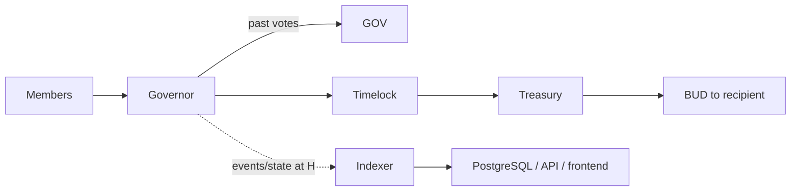
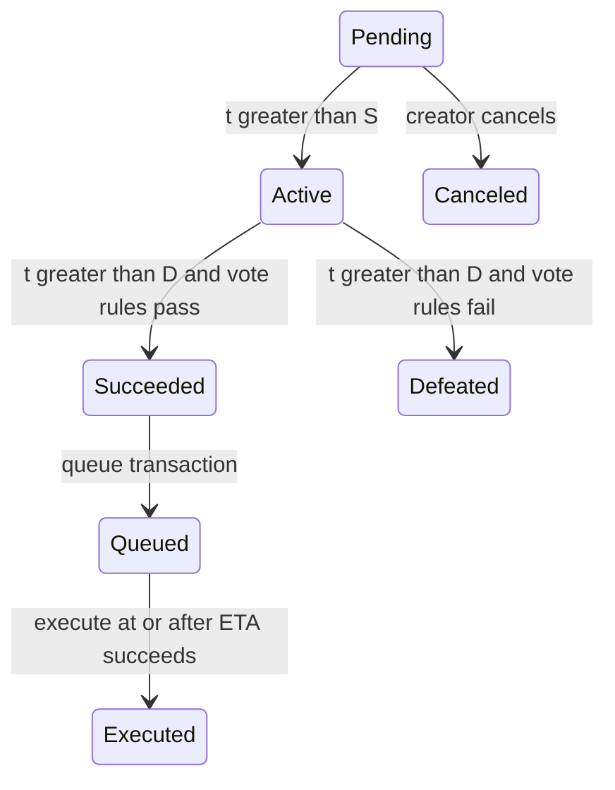
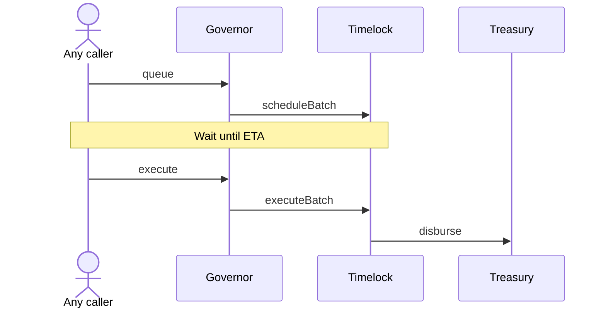

Markdown slide-ready, 8 slides; speaker notes tiếng Việt. Source sản phẩm
`f15f19252957d9ca37b424facdbb13afc8da0b05`, review28/11/2026.
Không yêu cầu thêm PowerPoint/Mermaid dependency. Slide separator là `---`.

## Slide 1 — Smart Contract Architecture

- GOV tracks voting power; BUD is the budget token.
- Governor decides; Timelock delays; Treasury pays.
- On-chain state is authoritative.
- Indexer → PostgreSQL → read API → frontend.

**Speaker notes:** Nêu năm contract, không coi PostgreSQL là nơi quyết định chi
tiền. Backend không ký thay user. Diagram đầy đủ trong tài liệu còn thể hiện
events Treasury/Timelock/BUD và delegation của members; sơ đồ slide rút gọn.

**Sources:** [Architecture](../contracts.md#năm-contract-và-nguồn-chân-lý),
[contract source](../../contracts/BudgetGovernor.sol).

---

## Slide 2 — Governance Token and Voting Power

- Fixed 1,000 GOV: A400 / B300 / C200 / D100.
- Self-delegation activates voting units.
- Timestamp checkpoints preserve historical power.
- Voting uses snapshot power, not current balance.

| Time | A token balance | A power for proposal |
|---|---:|---:|
| Snapshot after self-delegation | 400 | 400 |
| After snapshot: transfer all GOV | 0 | 400 |

**Speaker notes:** Delegate khác chuyển token. Snapshot S là timestamp; chỉ sau S
mới Active và đọc past power tại S. Đổi delegate/chuyển token sau S không thay
trọng số; update trong chính timestamp S vẫn thuộc checkpoint S.

**Sources:** [GovernanceToken](../../contracts/GovernanceToken.sol),
[`testBalanceTransferAfterSnapshotDoesNotChangeVoteWeight`](../../tests/unit/BudgetGovernor.t.sol).

---

## Slide 3 — Proposal Lifecycle

- Pending → Active after snapshot S.
- Voting: 60s delay, 300s period; threshold 50 GOV.
- After deadline: quorum + win → Succeeded, otherwise Defeated.
- Queue → wait 120s → execute; creator cancels only Pending.

**Speaker notes:** Đúng S vẫn Pending, đúng deadline vẫn Active. For+Abstain đạt
200 GOV và For>Against; hòa thất bại. Ready là operation condition, Governor vẫn
Queued; không có state Failed khi execute revert. Không có transaction tự động.

**Sources:** [Boundaries](../contracts.md#proposal-lifecycle-và-biên-thời-gian),
[Governor tests](../../tests/unit/BudgetGovernor.t.sol).

---

## Slide 4 — Governor → Timelock → Treasury

- Any gas-funded caller can queue/execute through Governor.
- Governor alone schedules/executes Timelock operations.
- Timelock alone holds Treasury spending authority.
- Deployer renounces bootstrap admins; no open executor.

**Speaker notes:** Governor kiểm quyết định biểu quyết; Timelock enforce khoảng
chờ; Treasury kiểm quyền chi/request/balance. Không gọi tắt: Governor không có
spender, user không có Timelock executor. Audit toàn lịch sử operation trước
renounce; revoke không tự hủy operation cũ. Khoảng chờ không cho emergency cancel.

**Sources:** [Roles/flow](../contracts.md#bootstrap-so-với-quyền-cuối-cùng),
[Timelock integration tests](../../tests/integration/TimelockGovernance.t.sol).

---

## Slide 5 — Treasury Security

- One successful payment per requestId.
- Validate role, recipient, amount and current BUD balance.
- Reverts roll back payment and execution flags.
- Top-up enables explicit retry; proposals reserve no funds.

| Demo | BUD |
|---|---:|
| Treasury before | 10,000 |
| Successful payment | 1,000 |
| Treasury after | 9,000 |

**Speaker notes:** Hai proposal dùng chung request vẫn được tạo, nhưng chỉ một
payment thắng. Request zero hợp lệ. Checks-effects-transfer chống lặp payment;
revert rollback cả Governor/Timelock/Treasury. Đây là đúng BUD đã audit, không
guarantee với mọi token có callback/fee. Không đếm queued amount là đã chi.

**Sources:** [Treasury](../../contracts/Treasury.sol),
[Treasury tests](../../tests/unit/Treasury.t.sol).

---

## Slide 6 — What-if Budget Simulation

- Draft PR62; not integrated into this Dev source.
- Inputs: balance, paid IDs, proposals and explicit step order.
- Outputs: hypothetical trace and projected balances.
- Eligibility/top-ups are assumptions; no transaction or reservation.

| Assumed order; balance10,000 | Result |
|---|---|
| 7,000 then 6,000 | First succeeds; final3,000 |
| 6,000 then 7,000 | First succeeds; final4,000 |

**Speaker notes:** Engine dùng bigint, không dự báo vote/quorum/gas/ETA. Adapter
đọc pinned H/hash chỉ baseline và paid flags cho supplied requests. Foundry VM
differential khác synthetic RPC adapter tests; chưa live adapter acceptance.
Không nối simulate với nút gửi transaction. SC06 là ABI/receipt handoff riêng.

**Sources:** [What-if model](../contracts.md#what-if-budget-trạng-thái-giả-định-khác-state-thực),
[PR62 engine at d4a0fb5](https://github.com/SE2026-21-1/dao-budget-simulator/blob/d4a0fb563e66be951760167a6f62b246821dc17c/simulator/engine.ts).

---

## Slide 7 — Data Consistency and Security Testing

- Reconcile state, votes, quorum and balance at one canonical H/hash.
- Count BUD Transfer once; link Treasury/Governor/Timelock events.
- INV01–04: uniqueness, authorized path, conservation, snapshot power.
- Current CI: 182 Foundry tests; SC06 suite32; bounded model ≠ formal proof.

**Speaker notes:** Voting snapshot S, raw checkpoint H và API publication là ba
khái niệm. Same-H rebuild không so H67 với latest. Một transaction có bốn nhóm
events không là bốn khoản chi. Integration40 và invariant properties đã nằm
trong182; không cộng chồng. Historical attack188 thuộc hai source khác, không
Dev182. Governance4properties chung5.000calls, không20.000; không unbounded proof.

**Sources:** [SC09 data review](../reviews/sc09-backend-data-review.md),
[exact-source CI log](https://github.com/SE2026-21-1/dao-budget-simulator/actions/runs/46151182866/job/140997955872).

---

## Slide 8 — Results and Limitations

- Contracts, ABI, local governance and reviewed read models are integrated.
- SC09 docs/report/slides are delivered for peer review.
- Sepolia source e17ef61 and TV4 owner confirmed; deployment pending.
- No Sybil protection, reserved funds or guaranteed future execution.
- Historical503 remains a documented limitation; no testnet/release PASS.

**Speaker notes:** Devf15f192 khác Sepolia pine17ef61 và evidence SHA lịch sử.
Owner/operator dung0611 đã nhận; không hỏi lại việc appoint. Còn public map,
custody/signers, funder/actual-map gas và explicit authorization user+owner.
K2 không consensus finality; API latency không bao gồm chờ transaction testnet.
Peer acceptance cần TV2/TV4, không tự merge/main/tag/release từ tài liệu này.

**Sources:** [SC10 owner/source confirmation](https://github.com/SE2026-21-1/dao-budget-simulator/issues/20#issuecomment-7240590072),
[TV1 report](../report/tv1-smart-contracts.md),
[Issue19 accepted limitation](https://github.com/SE2026-21-1/dao-budget-simulator/issues/19#issuecomment-7240299717).
